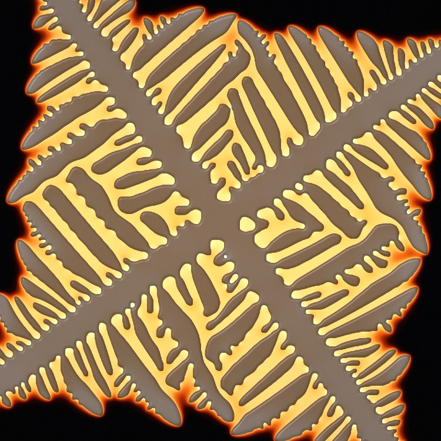
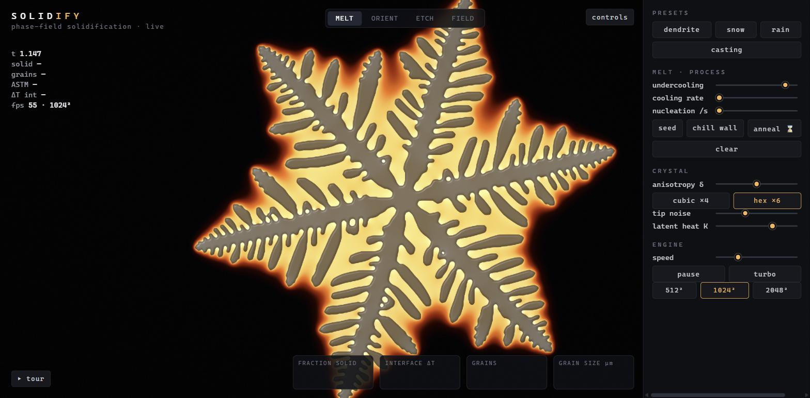
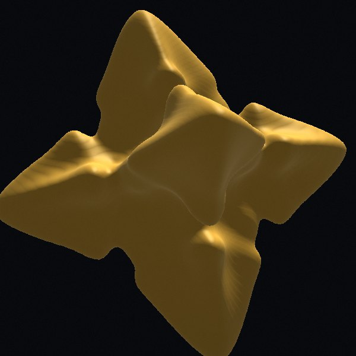

# SOLIDIFY

**Live app:** [solidify.frankcai.dev](https://solidify.frankcai.dev/) (requires WebGPU: Chrome, Edge, Safari 26+, or recent Firefox)  
**nanoHUB tool:** [nanohub.org/resources/solidify](https://nanohub.org/resources/solidify) (DOI: [10.21981/C2CG-F533](https://doi.org/10.21981/C2CG-F533)) | **PFHub dataset:** [10.5281/zenodo.24437743](https://doi.org/10.5281/zenodo.24437743)

SOLIDIFY is a browser-based WebGPU phase-field and Potts Monte Carlo solidification simulator. You can undercool a melt, nucleate crystals, watch dendrites grow and impinge into grains, and inspect the microstructure with metallographic lenses, cooling curves, grain-size histograms, and ASTM grain numbers.



Switching crystal symmetry from cubic (4-fold) to hexagonal (6-fold) grows a dendritic snowflake from the same equations (shown in cross-polarized orientation view):



## Quick start

```bash
npm install
npm run dev      # local dev server (WebGPU browser required)
npm run build    # static build to dist/
npm test         # full headless WebGPU verification suite (see TESTING.md)
```

Built with Vite, TypeScript, and raw WGSL compute/render shaders (no UI framework).

## Physics and numerics

### 2D phase-field solver

By default, SOLIDIFY runs the Kobayashi (1993) anisotropic phase-field model for an undercooled melt, extended to multiple grains:

- **Order parameter ($\phi$):** Anisotropic Allen-Cahn dynamics with $j$-fold surface-energy anisotropy $\varepsilon(\theta) = \bar{\varepsilon}(1 + \delta \cos j(\theta - \theta_0))$ and stochastic interface noise for side-branching.
- **Temperature ($T$):** Heat diffusion with latent-heat release $K\,\partial\phi/\partial t$. The bright halo around growing tips is released latent heat; recalescence warms the interface back toward the melting point and slows growth.
- **Polycrystals:** Each nucleus carries a crystallographic orientation $\theta_0$ in a grain-ID field propagated ahead of the solid-liquid front, so grain boundaries form where fronts impinge.

The 2D solver uses explicit Euler stepping on a $512^2$ to $2048^2$ grid with compact 9-point Laplacians and divergence-form anisotropy in WGSL, with GPU-fence backpressure so slower GPUs throttle without freezing the browser tab.

### Volumetric 3D mode (TRUE 3D)

Flipping **TRUE 3D** runs a full volumetric phase-field solver (up to $192^3 \approx 7.1$ million voxels) with live raymarching:



- **3D crystallography:** Per-grain quaternion orientations, cubic $\langle 100 \rangle$ six-armed dendrites, hexagonal plate/needle habits, faceted $\{100\}$ growth, icosahedral 5-fold quasicrystals, and $\Sigma 3$ twins ($60^\circ$ about $\langle 111 \rangle$, stamped with Shift-tap or spawned stochastically at the moving front).
- **Camera and lenses:** Orbit/dolly/pan with a ViewCube and nine volumetric lenses (`MELT`, `ORIENT`, `SLICE`, `FIELD` x-ray, `SEM`, `RINGS`, `THERM`, `NEON`, `CURV`).
- **Serial sectioning and stereology:** Free section plane (depth, tilt, turn, CT sweep) rendered as Nital/Klemm's/Beraha's etches, an EBSD-style [001] orientation map, or a Niyama porosity map. Includes live 2D section vs. true 3D volumetric grain-size comparison and pole figures.
- **Shrinkage porosity and Niyama:** A flood-fill from the top riser flags unfed liquid pockets that freeze into pores (dark in `FIELD` x-ray). Local Niyama values ($Ny$ in $\text{K}\cdot\text{s}^{1/2}\cdot\text{mm}^{-1}$) are checked against steel's $0.775$ radiographic threshold for steel and kept relative for other alloys. The Lab report also prints the Clyne-Davies hot-tearing timing ratio from $f_s(t)$.
- **Shaped molds and grain selector:** Rasterized mold masks (shell, plate, step block, wedge) restrict feeding, chill walls, and nucleation. A 3D helical pigtail grain selector stages 64 chill-floor grains (`8 x 8` jittered grid) under Bridgman directional pull; note that the automated test for this preset verifies staging only and does not assert a single exiting grain.
- **Export:** Watertight surface-nets STL mesh export, 6-second $360^\circ$ `.webm` turntable capture, and `#set=` share links carrying the full setup and RNG seed.

Memory footprint at $192^3$ is 57 bytes/voxel (~403 MB VRAM, plus ~57 MB when solute is enabled), with an OOM fallback ladder through $160^3$, $128^3$, and $96^3$.

## Instrument features

- **Lenses (2D):** `MELT`, `ORIENT`, `ETCH`, `FIELD`, `RINGS`, `THERM`, `SEM`, `NEON`, `XRAY` (solute absorption), and `CURV` (Gibbs-Thomson curvature).
- **Scenarios:** Free growth, Bridgman directional solidification, steerable/auto-raster laser welding, and qualitative 2D melt convection (D2Q9 TRT LBM velocity inlet up to $2048^2$ via split storage buffers; see `docs/D3-CONVECTION-DESIGN.md`).
- **Materials:** Eleven qualitative identities (model metal, Al-Cu, Fe-C steel, Ni superalloy, Co alloy, copper, Mg AZ91, Zn spangle, ice, succinonitrile, and the Al-Co-Ni decagonal quasicrystal, whose 10-fold interface energy is modeled while its aperiodic lattice is not). Crystal structure sets dendrite symmetry (FCC/BCC -> 4-fold, HCP -> 6-fold; cobalt freezes FCC).
- **Alloy composer and phase diagrams:** Pick a base (`Al`, `Fe`, `Ni`, `Mg`, `Cu`, `Zn`), enter solutes in wt% (with live at% conversion), and inspect dilute-limit liquidus shift $\Delta T_L = \sum m_i c_i$ and growth restriction factor $Q = \sum m_i c_i (k_i - 1)$, collapsed to a pseudo-binary solute field ($k_{\text{eff}}$) with explicit clamp warnings. Binary invariant rows live in `src/phasedata.ts` (table version `1.2.0`, audited in `docs/PHASE-RECONCILIATION.md`; equilibrium phase claims are withheld for Fe-Si and Mg-Zr where endpoints are unresolved). The composer draws the dominant binary diagram, contrasts equilibrium phases against the single primary phase the solver grows (printing lever vs. Gulliver-Scheil eutectic fractions and refusing single tie-line fractions on peritectics), and derives per-solute ceilings from the diagram (capping Fe-C at 0.52 wt% C against the 0.53 wt% peritectic so cast iron is excluded).
- **Unified v8.6 three-engine workspace (`SOLIDIFY` / `EUTECTIC` / `SPINODAL`):** A top switcher in the right rail swaps cleanly between dendritic solidification, 2D binary eutectic growth, and 2D/3D spinodal decomposition inside the same rail, sharing the top characterization lens bar (`PHASES` / `SOLUTE` / `ETCH`, `COMP` / `CHEM μ` / `ETCH`, `ISO 3D` / `SLICE` / `VOL`) and bottom-left playback transport with collapsible workflow panels.
- **2D lamellar eutectic mode (`eutectic`):** Dedicated three-phase simplex phase-field solver ($p_\alpha + p_\beta + p_L = 1$, Folch & Plapp 2005, *Phys. Rev. E* 72, 011602) with conservative solute diffusion in a moving directional frame, comparing live lamellar spacing $\lambda$ and front undercooling $\Delta T$ against Jackson & Hunt (1966) $\Delta T(\lambda) = K_1 V \lambda + K_2 / \lambda$ ($\lambda^2 V = K_2 / K_1$) across Al-Cu, Sn-Pb, Al-Si, and a symmetric reference. Caveats: 2D isotropic diffuse-interface model with enlarged interface width for interactive GPU stepping; irregular faceted Si flake growth in Al-Si is not modeled.
- **2D/3D spinodal decomposition mode (`spinodal`):** Conserved periodic Cahn-Hilliard solver ($\partial c/\partial t = \nabla \cdot (M \nabla \mu)$, $\mu = df/dc - \kappa \nabla^2 c$; Cahn & Hilliard 1958) in 2D ($200^2$ Mehrstellen stencil) and 3D ($64^3$ raymarched bicontinuous sponge) implementing NIST PFHub Benchmark 1 (Jokisaari et al. 2017) alongside Fe-Cr, Al-Zn, and off-critical droplet presets, with live Lyapunov free-energy $F(t)$ and Lifshitz-Slyozov-Wagner $L(t) \sim t^{1/3}$ coarsening diagnostics. Caveats: explicit periodic model with isotropic gradient energy; elastic coherency strain is omitted.
- **118-element periodic screen:** Below the quick solute buttons sits the periodic table with 118 cells colored for the melt. Across the six bases, 25 of the 708 (base, element) pairs are pourable and the other 683 are refusals with physical reasons (for example, mercury at 1 wt% exerts 0.053 atm over liquid aluminum, and pure mercury would exert 39). Switching base from aluminum to iron recolors 14 cells and puts a fume stripe under ten more whose boiling points sit between 660 °C and 1538 °C. The pourable set is unchanged: exactly the 25 pairs that already had both a cited coefficient row and a cited invariant.
- **Heterogeneous nucleation:** Inoculant sites (`n_max`) draw activation undercoolings from a Gaussian distribution (Thevoz-Rappaz / Greer free-growth model) and fire once when the melt reaches a new maximum undercooling. Recalescence halts further nucleation automatically, so faster cooling drives deeper undercooling and finer grains.
- **Lab mode:** Configure charge, inoculant, hold time, atmosphere, pour superheat, mold temperature/shape, cooling program, and an optional yield-strength spec, then pour and inspect the report card: thermal-analysis landmarks ($T_L$, $T_N$, recalescence, $T_S$), Sievert dissolved hydrogen (Ransley-Neufeld solubilities), refiner settling fade, per-section step-block grain size, and Hall-Petch $\sigma_y$.
- **Analysis, plots, and export:** Cooling-curve probe, Scheil overlay, linear-intercept SDAS ruler, live process plots with hover readouts and CSV/PNG export, deterministic RNG seeds in `#set=` links, one-button `.webm` capture, and **Export run** (ZIP archive with setup, seed, constants, CSVs, and rendered PNG).
- **Optimizer, challenge, and tour:** Separable CMA-ES grain-size optimizer (2D and 3D), Challenge mode, inline **learn** mode, a 32-chapter guided tour, and the equations/model-limits reference at [/science/](https://solidify.frankcai.dev/science/).

## Physical units and the calibrated solver

In default Kobayashi mode, three factors map dimensionless variables to SI:

| Factor | Value | Provenance |
|---|---|---|
| Kelvin per unit | ~249 K (Al), ~44 K (water) | Forced by $(L/c_p)/K$ |
| $\mu$m per cell | User-selected | Sets domain width $n \times (\mu\text{m/cell})$ |
| Seconds per unit | Derived | Forced by active diffusivity |

The `SCALE` panel reports each factor and flags unmatched dimensionless groups (Lewis number $Le \sim 1$ vs. $\sim 10^4$ in real liquid alloys; undefined capillary ratio in Kobayashi mode).

Enabling the **calibrated solver** in `ENGINE` / `SCALE` switches to Karma-Rappel thin-interface asymptotics tied to capillary length $d_0 = \Gamma/\Delta T_0$ and diffusivity $D$:

```text
d0 = a1 * W0 / lambda          a1 = 5*sqrt(2)/8 = 0.8839
tau0 = a2 * lambda * W0^2 / D  a2 = 0.6267
```

Choosing the convergence parameter $\lambda$ locks $W_0$, $\tau_0$, cell pitch, and timestep (for Al-4.5Cu: $d_0 = 3.2\text{ nm}$, $W_0 = 109\text{ nm}$, $0.087\ \mu\text{m/cell}$, $89\ \mu\text{m}$ field of view at $1024^2$). In alloys, an anti-trapping current cancels artificial solute trapping at finite interface width (holding $k_{\text{eff}} \in [0.135, 0.150]$ vs. true $k = 0.15$, compared to 24-40% high without it).

### 2D quantitative benchmarks

| Measurement | Literature reference | SOLIDIFY result |
|---|---|---|
| Steady tip velocity $V d_0 / D$ | Karma & Rappel (1998), 2D solvability ($\Delta = 0.55, \varepsilon_4 = 0.05$): **0.0170** | **0.01679** (1.2%) |
| Parabolic tip radius $\rho / d_0$ | Tong, Beckermann, Karma & Li (2001): 27.6 | 28.8 (4.4%) |
| Critical nucleus radius | Gibbs-Thomson $R^* = d_0/\Delta$ | 0.5% error |
| Interface-width independence | $W_0/d_0 = 1.8 \to 3.6$ | 6.4% spread |
| Effective partition coefficient | True $k = 0.15$ | 0.135-0.150 |

### 3D quantitative status

Calibrated 3D supports smooth cubic anisotropy, pure-melt heat diffusion, and dilute alloys with conserved face currents under an imposed temperature field (EFKP relaxation time). Hexagonal, icosahedral, and faceted modes remain on the qualitative solver. Verified 3D checks include the two-curvature critical sphere radius (1.56% error after refinement), planar Stefan front (0.934% error after refinement), closed-volume heat/solute conservation, 390/390 exact field hashes against the pre-refactor Kobayashi paths, and a full 5-arm converged-width moving-needle study at $\lambda = 2.8$ ($\Delta = 0.45, \varepsilon_4 = 0.0171$) on AWS NVIDIA L40S 48 GB (`domain`, `dt/2`, `width λ = 2.52`, and `dx = 0.6` up to $515 \times 515 \times 1166$): all 4 convergence controls pass (`5e-7` to `3.17%`) and all `5/5` arms pass the full multiplicative error + uncertainty + drift budget ($\le 10\%$) against Karma & Rappel (1996) Table I numerical solvability ($P = 0.324, \sigma^* = 0.0578$; `width` $\sigma^* = 0.05793$ [$+0.23\%$], `dx = 0.6` budget $2.73\% / 7.74\%$, independently CPU-replay verified across `305/305` checkpoints). Against KR96's finite-box (`200×200×400`) PF entry $\sigma^* = 0.063$ ($+9.0\%$ above KR96's own solvability value), budgets remain `15.9–18.0%`. See [`docs/QUANT-3D.md`](docs/QUANT-3D.md), [`docs/validation/q3c-narrow-ladder-2026-11-24.md`](docs/validation/q3c-narrow-ladder-2026-11-24.md), and [`docs/validation/q3c-optb-lam28-2026-11-25.md`](docs/validation/q3c-optb-lam28-2026-11-25.md) for full conditions and artifacts.

**Known limits:** 2D coupled alloys retain the $Le \sim 1$ mismatch, 3D alloys use an imposed temperature field, and the thin-interface expansion loses accuracy at high growth rates ($\tau_0 V / W_0 \approx 0.2$ near $\lambda \approx 4$ in deeply undercooled pure melts).

## Heat treatment (solid-state clock)

Solidification timesteps are $\sim 10^{-7}\text{ s}$, while furnace anneals span hours ($10^4\text{ s}$). SOLIDIFY models heat treatment in `src/heattreat.ts` on a separate solid-state clock with $\phi$ frozen:

```text
D^n - D0^n = integral k(T) dt   (sourced material law -> sets endpoint)
D^m - D0^m = K_MC * S           (measured Potts kinetics -> spends S sweeps)
```

Potts kinetics are calibrated directly on this lattice: $m = 2.44, K_{\text{MC}} = 4.79$ in 2D and $m = 2.25, K_{\text{MC}} = 1.28$ in 3D (6-cast spread $K/K_{\text{shipped}} \in [0.886, 1.186]$, gated at 25%).

| Check | Reference | Result |
|---|---|---|
| End-to-end anneal (12 h / 520 °C, Al, 1,595 grains) | Sourced growth law: $\bar{d} \to 50.4\ \mu\text{m}$ | 14.0 -> 48.6 $\mu\text{m}$ (ratio 0.963) |
| Solute homogenization | Discrete DCT-II eigenvalue | $9 \times 10^{-7}$ rel. error (2D & 3D) |
| $\Sigma 3$ annealing twins (3D) | Exact $60^\circ$ about $\langle 111 \rangle$ | 25/26 exact; Cu/Co twin, Al/Ni refuse by SFE |
| Parabolic oxide scale | $x = \sqrt{\int k_p\,dt}$ | Al: 2.3 nm (14.5 h, 520 °C); steel: mm scale |
| Hall-Petch $\sigma_y$ (1 h at $0.85\,T_m$) | $\sigma_y = \sigma_0 + k_{\text{HP}}/\sqrt{\bar{d}}$ | Al: 40 -> 36 MPa; steel: 243 -> 105 MPa |
| Stored-energy SIBM & recovery (3D) | Flat $\{100\}$ barrier $8\,J_b$; 3-pour selection | 73x to 6,238x share shift vs. $\pm 0.007$ control |

Additional solid-state controls include:
- **Zener pinning:** Grain growth is unpinned by default; dialing a particle dispersion pins boundaries at $d_{\lim} = 7.24\,r^{0.205}/f^{0.356}$ cells in 2D (mechanism shared in 3D without borrowing the 2D law).
- **Cold work and recrystallization (3D):** Per-grain stored energy in Potts bond units ($J_b$, 0-10) drives strain-induced boundary migration with analytic second-order recovery $H_S = H_0/(1 + \text{rec}\cdot H_0)$. Because sourced growth laws cover curvature only, dialing cold work withdraws the predicted grain-size endpoint and holds back $\Sigma 3$ twin insertion. An optional nuclei dial adds strain-free recrystallization nuclei (site-saturated or constant-rate, random or grain-boundary sites) and reports an Avrami exponent on the Monte Carlo sweep clock.
- **Precipitation age-hardening (opt-in T6):** Toggle `aging (T6)` in `heat treat` to superpose the Shercliff & Ashby (1990, *Acta Metall. Mater.* 38:1789-1802) process model ($\Delta\sigma_{\text{ss}}(\bar{P}) + \Delta\sigma_{\text{ppt}}(\bar{P})$ integrated across ramp + hold, with solvus dissolution to T4 above $T_{\text{solvus}}$ and live $\sigma_y$ vs. $\log_{10} t$ curve) on Hall-Petch $\sigma_y$ for three cited aluminum systems (`Al-Cu`, `A356`, and `AA2024`). Non-age-hardenable systems are refused explicitly.

**Known limits:** $\phi$ stays frozen (no re-solutioning), oxide scale is a card metric only, work hardening is not modeled, and precipitation aging applies strictly to the three cited aluminum systems when `aging (T6)` is enabled (off by default). Schedules that would exceed the domain's grain-statistics limit or trigger incipient melting are refused with the analytic value printed.

## Classroom labs, NIST PFHub, nanoHUB, and citation

- **Undergraduate MSE lab pack ([`docs/labs/`](docs/labs/README.md)):** Nine interactive in-app Guided Labs (`#lab=1` through `#lab=9`: dendrites and calibration, alloys and Scheil, 3D casting and Niyama, heat treat and Hall-Petch specs, cold work and recrystallization, directional growth/flow/selector, inverse process optimization, binary eutectic Jackson-Hunt scaling, and spinodal decomposition / LSW coarsening) with printable reports, Run-Export ZIPs, worksheets, and an instructor key.
- **NIST PFHub Benchmarks 3 and 1a ([`pfhub/`](pfhub/README.md)):** Reproducible WebGPU exporters (`scripts/export-pfhub-b3.mjs`, `scripts/export-pfhub-b1.mjs`), full Benchmark 3 $t = 1500$ ($2048^2$) dataset published on Zenodo ([10.5281/zenodo.24437743](https://doi.org/10.5281/zenodo.24437743)), and Benchmark 1a $t = 1000$ ($200^2$) verification bundle (`pfhub/results-b1-200/`, [`pfhub/PFHUB_B1_SUBMISSION.md`](pfhub/PFHUB_B1_SUBMISSION.md)).
- **Purdue nanoHUB ([`nanohub/`](nanohub/README.md)):** Published interactive tool at [nanohub.org/resources/solidify](https://nanohub.org/resources/solidify) (DOI: [10.21981/C2CG-F533](https://doi.org/10.21981/C2CG-F533)), pairing the WebGPU lab with a Jupyter notebook for Run-Export ZIP analysis via [`/middleware/invoke`](middleware/invoke).
- **Citation:** Metadata in [`CITATION.cff`](CITATION.cff) and [`codemeta.json`](codemeta.json) (MIT License; nanoHUB DOI `10.21981/C2CG-F533`; ORCID `0009-0003-0041-1459`).
