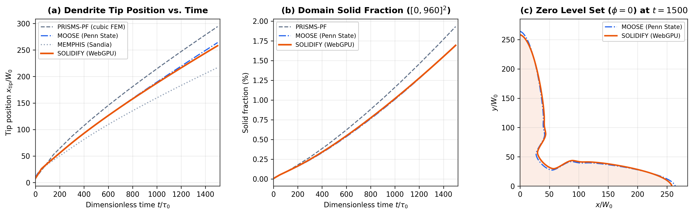

# NIST PFHub Benchmark 3 (Dendritic Growth) Submission Package

This folder holds SOLIDIFY's reproducible setup and output bundle for **NIST Phase Field Community Hub (PFHub) Benchmark Problem 3: Dendritic Growth** ([pages.nist.gov/pfhub/benchmarks/benchmark3.ipynb/](https://pages.nist.gov/pfhub/benchmarks/benchmark3.ipynb/)).

## Benchmark Specification Implemented
- **Model:** Quantitative Karma–Rappel thin-interface phase-field solver (`solver = 1` in `src/sim.ts`, 9-point explicit stencil in WGSL float32).
- **Domain & Symmetry:** Target benchmark quadrant $[0, 960]^2$, solved on the full 4-fold symmetric domain $[-960, +960]^2$ centered at $(n/2, n/2)$ so $x = 0$ and $y = 0$ are exact analytic mirror symmetry planes (even for $\phi$ and $U$; odd for the anisotropic cross fluxes $W W' \nabla\phi$), avoiding any clamped-corner boundary bias. All reported quantities are extracted over $[0, 960]^2$.
- **Parameters:** $W_0 = 1$, $\tau_0 = 1$, $D = 10$ ($\lambda = D / 0.6267 = 15.9566$), $m = 4$, $\varepsilon_4 = 0.05$, $\theta_0 = 0$, $\Delta = -0.3$, initial solid seed radius $R_0 = 8$ at $(0, 0)$, target time $t = 1500$.
- **Free Energy & Contour:** Computes the exact NIST Benchmark 3 free energy integral
  $$\mathcal{F} = \int_{[0,960]^2}\left[\frac{1}{2} W(\mathbf{n})^2 |\nabla\phi|^2 - \frac{1}{2}\phi^2 + \frac{1}{4}\phi^4 + \lambda U\phi\left(1 - \frac{2}{3}\phi^2 + \frac{1}{5}\phi^4\right)\right]\,dV$$
  and extracts the ordered zero level set ($\phi = 0$, $\psi = 0.5$) at $t = 1500$ via marching squares.

## Generating the Submission Dataset

Run the reproducible WebGPU exporter from the repository root:

```bash
# Quick smoke check (short horizon)
node scripts/export-pfhub-b3.mjs --grid=512 --tmax=50 --sample-dt=25 --out=verify-out/pfhub-smoke

# Full Benchmark 3 export (t = 1500 on full 2048x2048 => 1024x1024 quadrant [0,960]^2)
node scripts/export-pfhub-b3.mjs --grid=2048 --tmax=1500 --sample-dt=50 --out=pfhub/results-b3-2048
```

This writes the complete NIST PFHub & Zenodo bundle:
1. `bm3_results.csv` (`time,free_energy,tip_position,solid_fraction`)
2. `free_energy.csv`, `solid_fraction.csv`, `tip_position.csv`
3. `phase_field_1500.csv` (`x,y` ordered $\phi = 0$ zero level-set contour at $t = 1500$)
4. `meta.yaml` (official NIST PFHub YAML manifest)
5. `pfhub.json` (machine-readable provenance, hardware, and published-code diff summary)

## Benchmark 3 Results (`results-b3-2048`, $t = 1500$)

Executed in headless Chrome WebGPU on an integrated laptop GPU (`2048x2048` full symmetric domain $[-960, +960]^2$, `1024x1024` benchmark quadrant $[0, 960]^2$, $dx = 0.9375\,W_0$, $dt = 0.012742\,\tau_0$, `117,720` explicit steps, `507.2 s` solver time / `551.8 s` total wall time including 31 full-field readbacks):

| Code / Submission | Free Energy $\mathcal{F}(1500)$ | Solid Fraction $f_s(1500)$ | Tip Position $x_{\text{tip}}(1500)$ | Notes |
|---|---|---|---|---|
| **SOLIDIFY v8.0.0 (WebGPU)** | **1,991,161** | **0.016931** | **258.07** | Browser WGSL `f32`, 507 s (`results-b3-2048/`) |
| `moose_itg_3a` (Penn State MOOSE) | 1,988,326 (+0.14%) | 0.016984 (-0.31%) | 264.00 (-2.25%) | Adaptive FEM (8 cores, 228 s) |
| `inl_moose_3a` (INL MOOSE) | 1,976,212 (+0.76%) | 0.018780 (-9.85%) | 280.94 (-8.14%) | Adaptive FEM (6 cores, 67.5 s) |
| `PRISMS_PF_3a_cubic` (UMich) | 1,972,025 (+0.97%) | 0.019309 (-12.31%) | 294.14 (-12.26%) | Cubic adaptive FEM (6 cores, 178 s) |
| `memphis_3a` (Sandia MEMPHIS) | n/a | n/a | 216.84 (+19.01%) | Explicit Euler FD (16 cores, 8,215 s) |



## Uploading to Zenodo & PFHub
1. Ensure [`codemeta.json`](../codemeta.json) and the `v8.0.0` release are live on `https://github.com/fronkt/solidify`.
2. Zenodo dataset deposit staged at `https://zenodo.org/deposit/24437743` (reserved DOI: **`10.5281/zenodo.24437743`**) containing all 8 files in `pfhub/results-b3-2048/`.
3. Publish the Zenodo deposit and submit the dataset URLs + `https://github.com/fronkt/solidify` via the official [PFHub Upload Portal](https://pages.nist.gov/pfhub/simulations/upload_form/).
